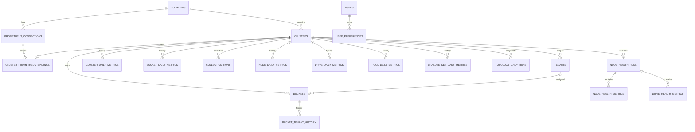
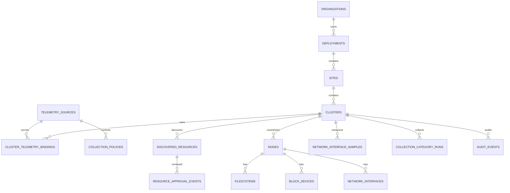
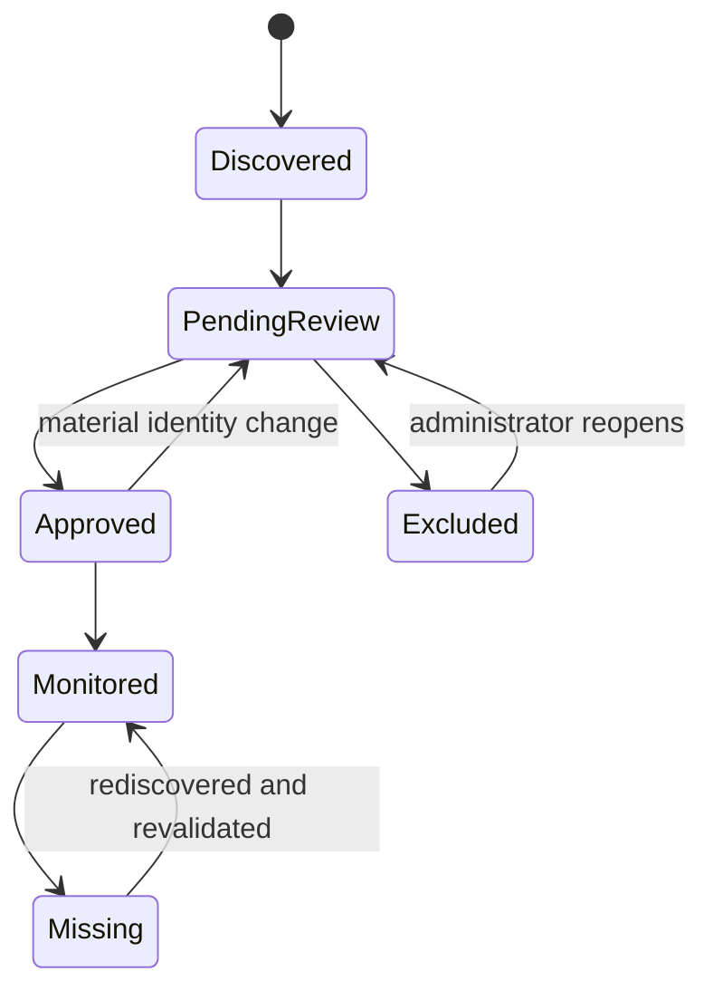

# MINIO Analytics — Current and Target Data Model

- **Baseline:** `feature/auth-foundation`
- **Status:** Architecture working document; target entities are proposals, not implemented schema
- **Prepared:** 2026-11-22

## 1. Modeling principles

1. Preserve existing location, cluster, tenant, bucket and history identities.
2. Use stable internal IDs; do not make hostnames or display names the primary identity.
3. Separate configuration/current inventory from time-series observations.
4. Separate discovery state and administrator approval from metrics collection.
5. Keep high-volume telemetry out of configuration and audit tables.
6. Make organization ownership explicit before hosted multi-tenant rollout.
7. Apply additive, tested migrations; do not silently delete historical data.

## 2. Current logical model

The following diagram reflects the inspected schema and migration-created tables at a logical level. It omits some columns and indexes for readability.

### Current entity groups

| Group | Tables/entities |
|---|---|
| Core inventory | `locations`, `clusters` |
| Prometheus configuration | `prometheus_connections`, `cluster_prometheus_bindings` |
| Tenant and bucket inventory | `tenants`, `buckets`, `bucket_tenant_history` |
| Daily analytics | `cluster_daily_metrics`, `bucket_daily_metrics` |
| Collection tracking | `collection_runs`, `scheduler_state` |
| Daily infrastructure | `node_daily_metrics`, `drive_daily_metrics`, `pool_daily_metrics`, `erasure_set_daily_metrics`, `topology_daily_runs` |
| Higher-frequency health | `node_health_runs`, `node_health_metrics`, `drive_health_metrics` |
| Identity and administration | `users`, `user_preferences`, `app_settings`, `settings_audit`, `schema_version` |

The precise installed schema must be confirmed against the deployed database before any migration is authored. Runtime databases may be at different schema versions.

## 3. Target logical model

The target model adds organization/deployment ownership, telemetry source configuration, discovered inventory and approval, collection policy and network telemetry. It is a staged target, not a request to create every table in one migration.

### Proposed entities

| Entity | Purpose | Key design considerations |
|---|---|---|
| `organizations` | Tenant/security boundary | Stable ID, status, lifecycle |
| `deployments` | Customer-managed or hosted deployment grouping | Deployment mode, ownership, region/site relationship |
| `sites` | Physical/logical location | Preserve current location identity during mapping |
| `clusters` | MinIO cluster identity | Stable ID independent of endpoint or display name |
| `telemetry_sources` | Monitoring provider connection | Initial provider is Prometheus only; credentials referenced securely |
| `cluster_telemetry_bindings` | Explicit association between a cluster and a telemetry source | Stores the cluster-to-source relationship and identity label/value; allows one source to serve multiple clusters where configured; validate uniqueness and ownership |
| `collection_policies` | Category enablement/cadence | Cluster/category scope, interval, limits |
| `collection_category_runs` | Operational collection status | Attempt/success, duration, freshness, counts, errors |
| `nodes` | Stable node inventory | Node identity distinct from exporter instance |
| `discovered_resources` | Discovered filesystem/device/interface records | Resource type, fingerprint, observed attributes, first/last seen |
| `resource_approval_events` | Review and classification history | Actor, action, previous/new state, timestamp |
| `filesystems` | Current approved filesystem inventory | Mountpoint, source, FS type, node, backing-device relationship |
| `block_devices` | Current approved block-device inventory | Device identity, parent, model, size, rotational attribute |
| `network_interfaces` | Current approved network inventory | Interface identity, bond/VLAN relationship, configured role |
| `network_interface_samples` | Network time-series | Counters/rates, errors, drops, link state, sample timestamp |
| `audit_events` | Security and configuration audit | Actor, organization, action, target, outcome, correlation ID |

## 4. Resource lifecycle

Rules:
- New resources are pending review.
- Approved resources can be monitored.
- Excluded resources remain visible but do not contribute to MinIO data totals.
- Missing resources retain history and are not silently deleted.
- Material identity changes require review rather than automatic reassignment.
- Approval and classification changes are audited.

## 5. Network interface role model

Allowed roles:
- `client_public`
- `cluster_internal`
- `shared`
- `other`
- `excluded`

Do not infer roles from interface names. Support node overrides. Do not double-count bond logical interfaces and physical slaves. A shared interface exposes aggregate throughput only unless flow-level telemetry can reliably distinguish traffic classes.

## 6. Migration sequence proposal

| Migration group | Scope | Dependency |
|---|---|---|
| M0 | Establish ordered migration framework and baseline checksums | None |
| M1 | Add organization/deployment/site ownership references, nullable during transition | M0 |
| M2 | Add telemetry source and cluster binding normalization | M0 |
| M3 | Add collection category policy and run status | M0, M2 |
| M4 | Add discovered resource and approval event model | M0, M1 |
| M5 | Add node/filesystem/block/network inventory relationships | M4 |
| M6 | Add network samples and retention indexes | M5 |
| M7 | Add organization-scoped audit and authorization references | M1 |

Do not run this sequence as one large migration. Each migration requires:
- Fresh database test.
- Upgrade test from every supported previous schema.
- Data-preservation assertions.
- Foreign-key and integrity checks.
- Backup/restore verification.
- Runtime validation on a copy of the lab database.

## 7. Open modeling questions

These questions require explicit product/architecture decisions before schema implementation:
1. Whether a deployment contains one or multiple sites in the first release.
2. Whether a telemetry source can be shared across clusters in different sites.
3. The canonical stable identity for nodes when exporter instance labels or hostnames change.
4. Resource fingerprint rules for devices, filesystems and network interfaces.
5. Whether detailed samples remain in SQLite for customer-managed small deployments and what measured threshold triggers an external time-series store.
6. How organization-level RBAC maps to existing administrator/viewer roles.

## 8. Non-goals

This document does not approve:
- Immediate schema migration.
- Database engine replacement.
- Direct MinIO polling.
- Push ingestion.
- VictoriaMetrics implementation.
- Automatic resource approval.
