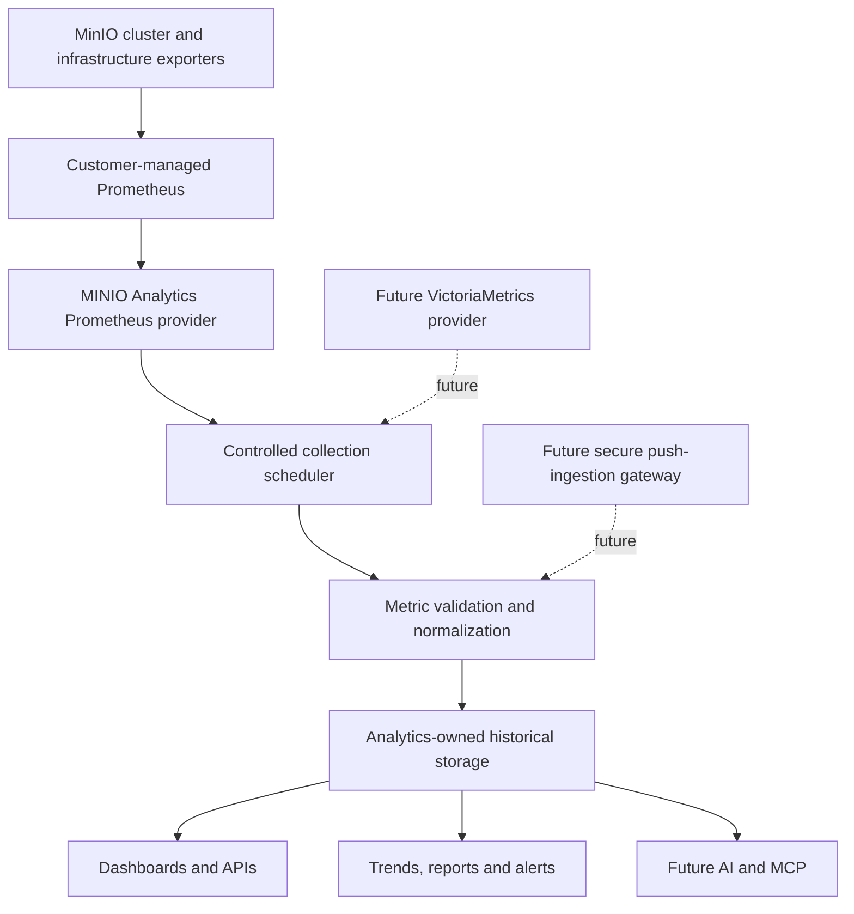

# ADR-001: Telemetry Sources and Collection Architecture

- **Status:** Accepted
- **Decision date:** 2026-11-21
- **Scope:** Phase 0 architecture baseline; Prometheus provider is the only provider in the initial implementation scope.

## Context

MINIO Analytics needs consistent, durable telemetry across multiple MinIO clusters while avoiding unnecessary load on customer storage systems and avoiding a runtime dependency from dashboards to customer monitoring systems.

Customers commonly operate their own monitoring platforms. Analytics should consume telemetry from those platforms rather than becoming another MinIO metrics scraper or requiring customers to replace their existing monitoring stack.

The current application already has a Prometheus HTTP API integration, scheduled collection, SQLite-backed history, and a dashboard path that reads persisted Analytics data. This ADR formalizes and extends that direction; it does not authorize a replacement collector or a broad refactor before the Phase 0 code audit.

## Decision

### 1. No direct MinIO metrics polling by Analytics

MINIO Analytics will not connect directly to MinIO metrics endpoints in the current product architecture. The direct-MinIO polling provider is out of scope and must not be added as a fallback.

The customer owns MinIO and infrastructure exporter scrape configuration, credentials, scrape targets, and Prometheus operation. Analytics consumes telemetry through a configured monitoring-platform API.

This does not mean Analytics manages or provisions customer Prometheus scrape jobs.

### 2. Prometheus is the initial supported telemetry provider

The initial provider is customer-managed Prometheus, accessed through its supported HTTP API.

- Prometheus connection details and cluster identity bindings remain configuration, not hardcoded application constants.
- A cluster is associated with an explicitly configured telemetry source.
- The provider must support the query patterns needed by the collection services and preserve cluster identity and metric provenance.
- TLS verification, authentication, timeouts, bounded concurrency, and safe endpoint validation are required.
- Missing, stale, malformed, or failed measurements remain unavailable; they must never be silently converted to zero.

Prometheus is the only provider to implement in this increment. Do not add VictoriaMetrics or remote-push ingestion now.

### 3. Provider selection is configurable per cluster

Introduce/retain a provider-neutral telemetry-source concept at the configuration and service boundary. Each cluster must be able to reference its own source configuration so different clusters can use different providers in a future release.

The initial supported provider value is `prometheus`. Future provider values may include:

- `victoriametrics` — planned future provider, not part of this implementation.
- `remote_ingestion` — planned future push-ingestion mode, not part of this implementation.

Do not expose unimplemented provider choices as usable configuration in the current UI/API. Do not build abstractions that duplicate the existing Prometheus collector without a demonstrated need. First map the current collector, connection, identity-binding, scheduler, and persistence code during Phase 0.

### 4. Analytics owns its historical record

Analytics must persist the telemetry needed for its dashboards, reports, alerts, and historical analysis in its own storage.

- Dashboards and normal user-facing analytics APIs read Analytics-owned persisted data.
- They must not query customer Prometheus live as their default data path.
- A live query may be considered later for an explicitly identified diagnostic workflow, with clear loading, timeout, authorization, and source-availability behaviour.
- Customer Prometheus retention is not Analytics retention.
- Analytics retention, downsampling/aggregation, and cleanup are managed independently.
- The product must expose data freshness and collection coverage so users can distinguish a healthy metric from missing or stale telemetry.
- A collection outage longer than customer Prometheus retention can create an unrecoverable historical gap; do not imply that Analytics can always backfill it.

The current SQLite persistence remains in place pending Phase 0 scale and retention assessment. This ADR does not approve a database migration.

### 5. Collection is selective and rate-controlled

Do not collect every metric family at high frequency.

Collection cadence is configurable by cluster and metric category. The design must support:
- Category-level enablement and disablement.
- Different cadences for availability, node performance, disk/network performance, filesystem/pool capacity, and detailed bucket inventory.
- Bounded concurrency, request timeouts, jitter, backoff, and controlled retries.
- Collection duration, sample/series counts where available, error state, last-success time, and freshness reporting.
- Retention policies appropriate to each data class.

Cadence values must be treated as product defaults only after representative benchmarking. Initial candidate intervals are illustrative and must be validated against metric cardinality, response size, cluster/node/bucket counts, Prometheus query cost, collector runtime, and Analytics storage growth. Do not turn illustrative intervals into immutable constants.

### 6. Future push ingestion is a separate capability

Customer-side push/remote ingestion is a planned later capability, primarily to support hosted deployments and environments where inbound connectivity to customer Prometheus is undesirable.

It is not implemented by this ADR. Do not treat Prometheus remote-write receiver as an automatically approved production ingestion architecture.

A future design must explicitly address tenant identity binding, authentication/mTLS, credential rotation and revocation, replay/deduplication, buffering, retries, backpressure, payload and rate limits, schema compatibility, isolation, and auditability. Tenant identity must be derived from trusted credentials/configuration, not trusted solely from labels in an incoming payload.

## Conceptual architecture

## Responsibilities

| Concern | Owner |
|---|---|
| MinIO and exporter scrape targets | Customer monitoring platform |
| Prometheus availability, scrape configuration and retention | Customer |
| Telemetry source connection and cluster identity mapping | MINIO Analytics administrator |
| Collection schedule, bounded workload and retries | MINIO Analytics |
| Metric normalization and data-quality/freshness status | MINIO Analytics |
| Analytics historical retention and dashboard query path | MINIO Analytics |
| Future push-ingestion security and delivery guarantees | MINIO Analytics, in a later design |

## Consequences

### Positive

- Reuses the customer's established monitoring platform.
- Avoids a second direct MinIO scrape path and duplicated scrape load.
- Keeps dashboard responsiveness independent of customer Prometheus request latency.
- Gives Analytics independent history, normalization, reporting, and MinIO-specific intelligence.
- Allows future provider diversity without making the current release multi-provider.

### Trade-offs and risks

- Analytics depends on the configured monitoring API for new telemetry collection.
- Metric availability, labels, scrape intervals, and source retention vary by customer.
- Analytics may have historical gaps if its collector is unavailable beyond source retention.
- Provider-neutral boundaries require careful design to avoid hiding meaningful differences between Prometheus-compatible systems.

## Phase 0 requirements before implementation

1. Inventory existing Prometheus connection models, credentials, identity bindings, collectors, scheduler jobs, APIs, and persistence tables.
2. Document the current metric families and their source jobs/labels, including cluster, node, drive, filesystem, network, pool, erasure-set, and bucket metrics.
3. Identify duplicated queries, redundant scrapes, high-cardinality families, and current collection frequencies.
4. Define normalized metric identities and provenance without losing source labels needed for troubleshooting.
5. Review endpoint validation and SSRF protections, TLS verification, credential storage, authorization, timeouts, retries, and audit coverage.
6. Measure query response size, execution duration, series count, collector runtime, and storage growth at representative scale.
7. Define per-category cadence and retention defaults from measured evidence.
8. Preserve existing validated collection and history behaviour; use additive, versioned migrations if schema changes are justified.
9. Add tests for source failures, stale data, partial metric-family success, identity ambiguity, missing values, retry/backoff, and retention boundaries.
10. Revisit the provider abstraction only after this audit. Implement Prometheus first; defer VictoriaMetrics and push ingestion.

## Explicit non-goals

- Direct Analytics polling of MinIO metrics endpoints.
- Analytics-managed customer Prometheus scrape-target configuration.
- VictoriaMetrics implementation in the current increment.
- Push/remote-write ingestion implementation in the current increment.
- High-frequency collection of every metric family.
- Live customer Prometheus queries as the default dashboard data path.
- A database migration solely to anticipate future scale.
