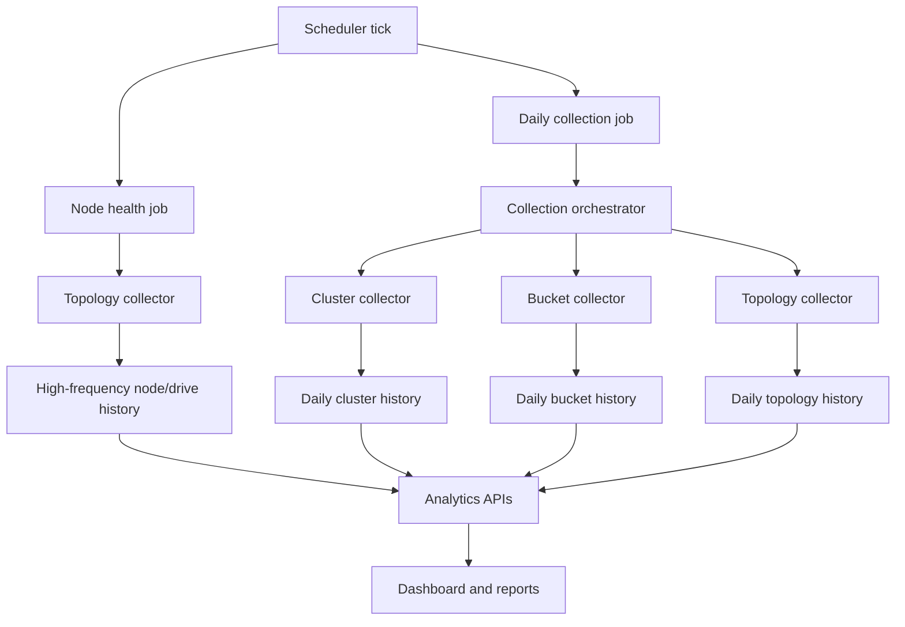
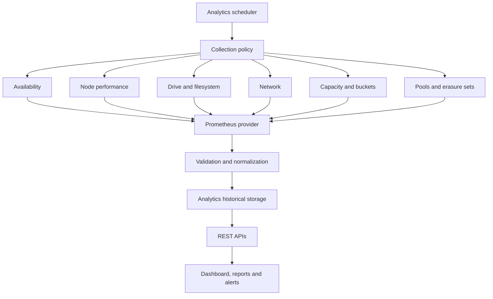

# Phase 0 Architecture and Codebase Audit

- **Product:** MINIO Analytics
- **Baseline:** `feature/auth-foundation`
- **Audit type:** Static source review
- **Status:** Refreshed static source review against `feature/auth-foundation` at `850d6394e61948a11f40e80c0ce4b7cc427466ba`; runtime, load, security-penetration and deployment validation remain outstanding
- **Prepared:** 2026-11-23

## 1. Executive summary

The repository already contains a meaningful MinIO analytics foundation: multi-location and multi-cluster configuration, Prometheus API collection, daily cluster and bucket history, topology snapshots, higher-frequency node/drive health samples, tenant-to-bucket mapping, authenticated APIs, reports, scheduler jobs and database backup support.

The recommended approach is evolutionary. Preserve the current collectors, persistence contracts, APIs and user experience while strengthening the boundaries around migrations, Prometheus connectivity, discovery/approval, collection policy and collection-health reporting.

This document is an engineering assessment, not a declaration that the application is production-certified.

## 2. Scope and evidence

The review inspected the following files on `feature/auth-foundation`:

| Area | Source files |
|---|---|
| Database | `app/database/schema.sql`, `app/database/database.py`, `app/database/persistence.py` |
| Prometheus | `app/collectors/prometheus.py`, `app/collectors/prometheus_discovery.py`, `app/database/prometheus_config.py` |
| Collection | `app/collectors/orchestrator.py`, `app/collectors/cluster_collector.py`, `app/collectors/bucket_collector.py`, `app/collectors/topology_collector.py`, `app/collectors/node_health.py` |
| API | `app/api/analytics.py`, `app/api/clusters.py`, `app/api/tenants.py`, `app/api/master_admin.py`, `app/api/auth.py` |
| Authentication | `app/auth/security.py`, `app/auth/dependencies.py` |
| Configuration and scheduling | `app/config/loader.py`, `scripts/scheduler_tick.py` |
| Tests and CI | `tests/conftest.py`, `.github/workflows/tests.yml` |

This is a static source review. GitHub workflow results are recorded separately from any runtime validation. No customer VM, live Prometheus endpoint, load test or penetration test was exercised during this audit.

## 3. Existing strengths to preserve

1. The application already models locations and clusters separately.
2. Prometheus is accessed through an application collector/client rather than from dashboard JavaScript.
3. Collection data is persisted and the normal analytics experience reads the application's own history.
4. Cluster and bucket gauges that repeat across MinIO targets are deduplicated rather than blindly summed.
5. Failed or missing metric values are generally represented as unavailable/NULL, not as zero.
6. Collection runs capture status, attempts and error details; partial metric-family success can be persisted.
7. Bucket tenant attribution is snapshotted so later reassignment does not rewrite historical ownership.
8. Node and drive high-frequency history is distinct from daily topology history.
9. SQLite WAL, foreign keys, busy timeout and a backup path are present.
10. Existing role-based authentication and admin-protected configuration endpoints provide a foundation to harden.

Do not replace these working capabilities merely to achieve a theoretically cleaner architecture.

## 4. Findings and recommendations

### P0 — Database migration governance

**Previously observed and now remediated on this baseline:** The earlier audit identified risk in using `executescript()` during SQLite migration execution because of its implicit transaction behaviour. PR #38 was merged into the current integration baseline at `850d6394e61948a11f40e80c0ce4b7cc427466ba` and addresses that specific issue.

**Verified implementation direction:** Migration execution now uses an explicit `BEGIN IMMEDIATE`, executes SQL statements individually rather than relying on `executescript()`, applies base schema and migrations within the same transaction, commits only after successful completion, and rolls back on failure. Regression tests cover rollback behaviour and SQL statement parsing. The exact implementation and CI evidence are recorded in the Engineering Handover.

**Remaining governance work:** This remediation does not by itself establish a complete long-term migration governance process. The following remain to be assessed:
- Inventory every supported schema version and migration path, including deployed database versions.
- Define immutable, ordered migration identities and clear version/checksum policy.
- Test fresh database initialization and upgrades from representative supported historical schemas.
- Assert preservation of users, tenants, buckets, historical metrics and configuration.
- Define backup-before-upgrade, integrity verification and restore procedures.
- Validate upgrades against a copy of the actual lab database before any deployment.

Do not describe the former `executescript()` transaction defect as an outstanding current P0 finding on this integration baseline. Do not infer that the VM has received PR #38; deployed runtime state remains unverified.

### P0 — Prometheus connection security

**Observed:** Prometheus endpoint configuration is represented in SQLite as protocol, hostname, port and TLS verification. The Prometheus client supports HTTP API requests and configurable TLS verification/timeouts. The cluster discovery API accepts a hostname and port from an administrator and makes an outbound connection.

**Risk:** Hosted deployment and customer-managed deployments need a deliberate outbound connection security boundary. Authentication/credential lifecycle and SSRF protections were not established as complete in the reviewed connection model.

**Recommendation:**
- Support appropriate Prometheus authentication without placing credentials in endpoint URLs.
- Store secrets outside ordinary configuration rows, with encryption/secret-provider integration and redaction.
- Validate scheme, hostname, port, resolved addresses and redirects; block loopback, link-local, metadata and other prohibited destinations unless explicitly allowed by deployment policy.
- Apply request timeouts, response-size limits, bounded concurrency, query limits and controlled retries.
- Verify TLS by default; make any exception explicit, visible and audited.
- Test DNS rebinding and redirect behavior for hosted deployments.
- Never log bearer tokens, authorization headers or credential-bearing URLs.

### P0 — Infrastructure discovery and approval

**Observed:** Topology collection derives node/drive/filesystem observations from Prometheus metrics. The inspected implementation includes assumptions about filesystem naming/mountpoint patterns and uses a hardcoded `cluster` label in at least one filesystem metric selection path while cluster identity is otherwise configurable.

**Risk:** Customers have different mountpoints, device naming, exporter labels, bond/VLAN arrangements and storage layouts. Metrics collection is not a substitute for authoritative inventory relationships or administrator approval.

**Recommendation:**
- Separate inventory discovery from metric collection.
- Store discovered filesystem, block-device and network-interface identities with node association and observed attributes.
- Use configurable cluster identity consistently across all metric families.
- Introduce explicit pending-review, approved, excluded and missing states.
- Preserve historical observations when a resource disappears.
- Never silently classify a newly discovered disk or mount as MinIO data.
- Support cluster defaults and node-level overrides.
- Validate the actual collector's metric selectors against the user's lab and supported exporter versions before implementation.

### P1 — Collection policy and workload control

**Observed:** The application has a scheduler tick, a higher-frequency node-health job and daily collection. Existing settings include a node interval and daily collection time. The collection orchestrator retries cluster collection and may repeat successful metric-family work when a sibling family fails.

**Risk:** At scale, one global interval and broad retries can create unnecessary Prometheus query load. A multi-cluster installation needs category-specific collection policy, concurrency bounds and visibility into collection cost.

**Recommendation:**
- Add category-level enablement and cadence.
- Separate availability, node performance, drive/filesystem, network, pool/topology, capacity and bucket inventory collection.
- Bound concurrency per Prometheus connection and across the application.
- Add jitter, timeouts, exponential backoff and retry budgets.
- Avoid re-running successful families unnecessarily.
- Record duration, last attempt, last success, sample/series counts where available, error category and data freshness.
- Benchmark before selecting production defaults; retain configurable defaults rather than claiming one cadence suits every installation.

### P1 — Network observability

**Observed:** The reviewed schema and persistence path contain node, drive, pool and erasure-set history. A dedicated network-interface inventory and historical network telemetry model was not identified.

**Recommendation:**
- Add interface inventory and time-series samples for receive/transmit bytes, packets, errors, drops and link state where available.
- Support configured roles: client/public, cluster/internal, shared, other and excluded.
- Do not infer role from interface names.
- Avoid double-counting a bond and its physical slaves.
- For a shared interface, report total throughput; do not claim client/internal split without flow-level evidence.

### P1 — Hosted organization isolation

**Observed:** Locations, clusters, users, roles and tenants exist. The reviewed model does not yet provide a complete organization/deployment hierarchy with organization-scoped authorization.

**Recommendation:**
- Keep customer-managed single-organization operation straightforward.
- Introduce organization and deployment ownership as additive, explicit relationships.
- Scope all hosted reads, writes, background jobs, exports and object lookups to the authenticated organization.
- Add cross-tenant negative authorization tests before hosted rollout.
- Do not force this schema change into the migration and discovery stabilization increment.

### P1 — Collection Health completeness

**Observed:** Collection runs and scheduler state exist, including partial results and family errors. A complete category-level freshness and coverage model is not yet established.

**Recommendation:** Report last attempt, last success, expected interval, actual interval, freshness, coverage, duration, errors, stale state and provider reachability independently for each collection category. Keep these operational signals separate from Node Infrastructure measurements.

### P2 — API contract and compatibility

**Observed:** The API is functional but currently organized around existing route prefixes such as `/api/analytics`, `/api/clusters`, `/api/tenants` and `/api/master-admin`.

**Recommendation:** Produce and test a route/schema inventory before introducing a versioned `/api/v1` surface. Preserve existing clients during migration; use compatibility adapters or a documented deprecation period.

### P2 — Scale and retention evidence

**Not yet established:** Safe maximum cluster count, node count, drive count, metric cardinality, SQLite write concurrency, history retention footprint and query latency under representative load.

**Recommendation:** Build repeatable synthetic/load benchmarks and use measured data volume, query duration and write contention to decide when a different persistence engine or time-series store is justified.

## 5. Current collection flow

This is the current conceptual flow. It is not a replacement design.

## 6. Target collection direction

The target must reuse the existing Prometheus client and collectors wherever practical. A provider boundary is not permission to rewrite collectors without evidence.

## 7. Security review checklist

- [ ] Prometheus authentication method and secret lifecycle documented.
- [ ] Secret storage encrypted or delegated to a supported secret provider.
- [ ] Outbound endpoint allowlist and SSRF policy implemented.
- [ ] DNS resolution, redirects and prohibited address ranges validated.
- [ ] TLS verification enabled by default.
- [ ] Request timeout, response-size and query-cost limits enforced.
- [ ] Authentication/session CSRF and login-throttling assessment completed.
- [ ] Authorization tests cover every sensitive API and export.
- [ ] Audit records cover security-relevant configuration changes.
- [ ] Logs redact secrets and sensitive connection details.
- [ ] Hosted tenant-isolation tests pass before hosted deployment.

## 8. Phase 0 exit criteria

Phase 0 is complete only when the project has:
1. A reviewed current-versus-target ERD.
2. A route/API inventory and compatibility plan.
3. A migration inventory and tested migration strategy.
4. A Prometheus connection threat model and security test plan.
5. An inventory discovery/approval design.
6. A collection category and scheduling policy.
7. A scale/retention benchmark plan with measurable acceptance criteria.
8. A prioritized backlog with dependencies and explicit exclusions.

## 9. Explicit non-goals for this increment

- No direct MinIO metrics polling by Analytics.
- No VictoriaMetrics provider implementation.
- No remote/push ingestion implementation.
- No MCP write operations.
- No automatic destructive inventory changes.
- No forced SQLite-to-PostgreSQL migration.
- No broad collector rewrite.
- No production deployment or merge authorization implied by this audit.

## 10. Decision summary

Proceed incrementally: stabilize migration governance and Prometheus connection security; then implement discovery/approval and category-aware collection health; then add network observability and hosted organization isolation. Preserve the existing analytics features and validate every change against fresh and upgraded databases, API regression tests and the lab runtime.
